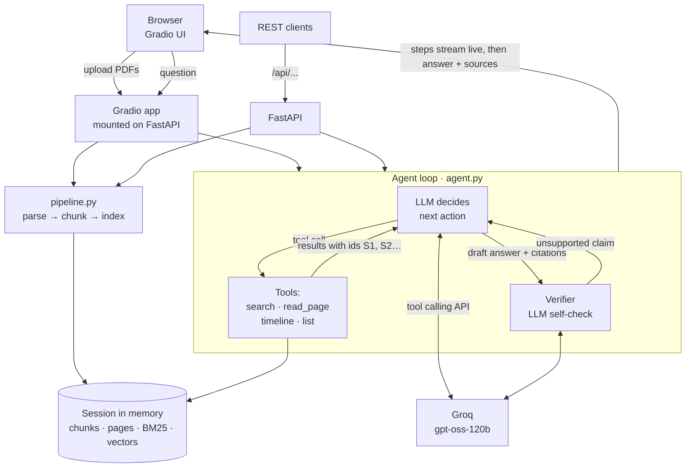

# OpsPilot: Agentic RAG for Incident PDFs

> Upload incident PDFs, then ask questions about them. An AI agent searches the documents, checks its own answer, and
> shows the file and page every fact came from.

OpsPilot is a free, open-source **agentic Retrieval-Augmented Generation (RAG)** app for IT operations teams, with a
**Gradio** web interface. You upload incident reports, shift logs or post-mortems as PDFs and ask questions in plain
English, such as *"Why did the job fail?"*, *"Who approved the rerun?"* or *"Give me a timeline"*.

Instead of searching once and hoping the right passage comes back, OpsPilot's agent **decides what to look up**,
calls search tools as many times as it needs, writes an answer with citations, then **verifies** that answer against
the cited pages before showing it. You can watch every step in the chat.

| | |
|---|---|
| **Live demo** | `https://<your-hf-username>-opspilot.hf.space` (see [Deploy a public URL](#11-deploy-a-public-url-free)) |
| **User interface** | **Gradio 6** (chat UI with live, collapsible agent steps) |
| **AI model (LLM)** | **OpenAI gpt-oss-120b** (`openai/gpt-oss-120b`), open weights, on the **Groq** free tier, with tool calling |
| **Embedding model** | **BAAI bge-small-en-v1.5**, running locally (free, no API) |
| **RAG style** | Agentic: plan → tool calls → answer with citations → self-check → revise |
| **Cost** | **0**. Every part is open source or a free tier. No credit card needed anywhere. |
| **Works without an API key?** | **Yes**, in *quote mode*: answers are exact sentences from your PDFs. |
| **License** | MIT |

---

## Table of contents

1. [What problem does it solve?](#1-what-problem-does-it-solve)
2. [Features](#2-features)
3. [Tech stack](#3-tech-stack)
4. [Which AI models are used (and why)](#4-which-ai-models-are-used-and-why)
5. [What makes it agentic](#5-what-makes-it-agentic)
6. [Architecture](#6-architecture)
7. [A question, step by step](#7-a-question-step-by-step)
8. [How the project was built](#8-how-the-project-was-built)
9. [Project structure, file by file](#9-project-structure-file-by-file)
10. [Run it on your computer with VS Code](#10-run-it-on-your-computer-with-vs-code)
11. [Deploy a public URL (free)](#11-deploy-a-public-url-free)
12. [Upload it to GitHub](#12-upload-it-to-github)
13. [Configuration reference](#13-configuration-reference)
14. [REST API reference](#14-rest-api-reference)
15. [Testing and code quality](#15-testing-and-code-quality)
16. [Security and privacy](#16-security-and-privacy)
17. [Troubleshooting](#17-troubleshooting)
18. [Limitations and roadmap](#18-limitations-and-roadmap)
19. [License and credits](#19-license-and-credits)

---

## 1. What problem does it solve?

After an incident, the facts are spread across long PDFs: the incident report, the shift log, the post-mortem.
Answering *"what time did the feed arrive, and who approved the fix?"* means opening several files and searching by
hand. General chatbots can't be trusted here because they may **make up** a plausible answer.

OpsPilot fixes this:

- It **searches all uploaded PDFs** and answers in seconds.
- It is **grounded**: the agent only sees passages from your PDFs, must cite them, and must say when the answer
  isn't there.
- It is **self-checking**: a second model call verifies every claim before you see it.
- It is **transparent**: the chat shows each search, page read and check the agent made.

---

## 2. Features

| Feature | Description |
|---|---|
| Gradio chat UI | Upload screen, then a chat with an incident summary panel. Light and dark mode, works on phones. |
| Agentic RAG | The LLM plans, calls tools (search, read page, timeline, list files), answers, self-checks and revises. |
| Live agent steps | Each tool call appears in the chat as a collapsible step, e.g. *🔎 Searched: "job failure root cause"*. |
| Page-level citations | Each answer has tags like `incident_report_INC-1042.pdf p.2` plus a *Source passages* panel. |
| Refuses to guess | Ask *"Who was the on-call engineer?"* on the sample: it says the PDFs don't contain this. |
| Incident summary | **What happened**, **Impact**, **Status** and **Missing from the reports**. |
| Hybrid search | Keyword search (BM25) plus meaning-based search (embeddings), merged with Reciprocal Rank Fusion. |
| Three answer levels | Agent → single-shot RAG (if tool calling fails) → quote mode (if there's no key or the LLM is down). |
| Sample incident | One click loads a sample incident report (3 pages) and shift log (5 pages). |
| REST API | The same features over HTTP at `/api/...`, with interactive docs at `/docs`. |
| Privacy | PDFs are processed in memory only and deleted after 60 minutes. Nothing is written to disk. |
| Production basics | Input validation, upload limits, per-visitor rate limiting, health check, Docker, CI, 63 tests. |

---

## 3. Tech stack

Everything below is free and open source, or a free tier.

| Layer | Technology | Version | What it's used for |
|---|---|---|---|
| **Language** | Python | 3.11 (3.10+ works) | Whole project |
| **User interface** | [Gradio](https://www.gradio.app) | 6.30 | Chat UI, file upload, agent-step display |
| **Web server / API** | [FastAPI](https://fastapi.tiangolo.com) + [Uvicorn](https://www.uvicorn.org) | 0.143 / 0.54 | REST API, hosts the Gradio app at `/` |
| **LLM** | OpenAI **gpt-oss-120b** (open weights) via [Groq](https://console.groq.com) | `openai/gpt-oss-120b` | Agent reasoning, tool calling, answers, self-check, summary |
| **LLM client** | [httpx](https://www.python-httpx.org) (OpenAI-compatible REST) | 0.28 | Calls Groq, or any OpenAI-compatible provider |
| **Agent framework** | Custom tool-calling loop (`backend/app/agent.py`) | – | Plan → act → answer → verify; no heavy framework needed |
| **Embeddings** | **BAAI bge-small-en-v1.5** via [fastembed](https://github.com/qdrant/fastembed) (ONNX Runtime) | 0.9 | Meaning-based search, on CPU |
| **Keyword search** | BM25, written in plain Python | – | Exact terms such as `return code 12`, `nightly_batch_07` |
| **Rank fusion** | Reciprocal Rank Fusion (RRF) | – | Merges keyword and embedding rankings |
| **PDF parsing** | [pypdf](https://pypdf.readthedocs.io) | 6.21 | Extracts text page by page |
| **Settings** | [pydantic-settings](https://docs.pydantic.dev/latest/concepts/pydantic_settings/) | 2.16 | Reads `.env` / environment variables |
| **Validation** | [Pydantic](https://docs.pydantic.dev) | 2 | API request/response models |
| **Sample PDFs** | [ReportLab](https://www.reportlab.com/opensource/) | 5.0 | Generates the sample incident PDFs (dev only) |
| **Testing** | [pytest](https://pytest.org) | 9.1 | 63 offline tests |
| **Lint / format** | [Ruff](https://docs.astral.sh/ruff/) | 0.17 | Code style |
| **Container** | Docker (python:3.11-slim) | – | Production image |
| **CI/CD** | GitHub Actions | – | Lint, test, Docker build; optional auto-deploy |
| **Hosting** | [Hugging Face Spaces](https://huggingface.co/spaces) (Docker, free CPU) or [Render](https://render.com) free plan | – | Public URL |
| **Editor** | VS Code (Python, Debugpy, Ruff extensions) | – | Run/debug configs included in `.vscode/` |

---

## 4. Which AI models are used (and why)

### 4.1 The LLM (the agent's brain): OpenAI gpt-oss-120b on Groq

| | |
|---|---|
| **Model** | gpt-oss-120b, an open-weight reasoning model released by OpenAI (Apache 2.0 licence) |
| **Model ID** | `openai/gpt-oss-120b` |
| **Provider** | [Groq](https://console.groq.com) (runs it on fast LPU hardware) |
| **Cost** | Free tier, no credit card. The free tier limits requests and tokens per minute and per day (for example 8,000 tokens per minute at the time of testing); see your account's [limits page](https://console.groq.com/settings/limits). |
| **Context window** | 131,072 tokens |
| **Used for** | (1) choosing and calling tools, (2) writing the cited answer, (3) self-checking the answer, (4) writing the incident summary as JSON |
| **Settings** | `temperature = 0.1`, `max_tokens = 1500` (room for its hidden reasoning), up to 3 tool-calling rounds per question |
| **Where in code** | [`backend/app/llm.py`](backend/app/llm.py) (API client), [`backend/app/agent.py`](backend/app/agent.py) (agent prompts and loop) |

**Why this model?**

- **Built for tool calling**, which the agent depends on: it picks the right tool and arguments reliably.
- **Follows grounding rules well**: it cites sources and says `NOT_FOUND` instead of guessing.
- **Fast on Groq**: a typical answer (one search plus the self-check) takes about 2–3 seconds.
- **Free** with a generous context window.

This project first used Meta's Llama 3.3 70B on Groq. It no longer appeared in Groq's model list for the project's key
when tested, so the default moved to gpt-oss-120b.

**Free-tier tips.** Each question makes about 2–4 LLM calls. If you hit the per-minute limit, OpsPilot waits briefly
and retries, and otherwise answers in quote mode. To use fewer tokens, set `AGENT_VERIFY=false` or switch to
`openai/gpt-oss-20b`.

**Switching models.** OpsPilot uses the standard *OpenAI-compatible* chat API, so you can change provider with two
settings in `.env`. For agent mode, the model must support tool calling.

| Provider | `LLM_BASE_URL` | `LLM_MODEL` | Notes |
|---|---|---|---|
| **Groq** (default) | `https://api.groq.com/openai/v1` | `openai/gpt-oss-120b` | Free key at console.groq.com |
| Groq, smaller and faster | `https://api.groq.com/openai/v1` | `openai/gpt-oss-20b` | Uses fewer tokens, weaker agent |
| Groq, Qwen | `https://api.groq.com/openai/v1` | `qwen/qwen3.8-27b` | Open-weight model from Alibaba, supports tools |
| Google Gemini | `https://generativelanguage.googleapis.com/v1beta/openai` | `gemini-3.8-flash` | Free key at aistudio.google.com |
| OpenRouter | `https://openrouter.ai/api/v1` | `meta-llama/llama-3.3-70b-instruct:free` | Free models, key at openrouter.ai |
| Ollama (offline) | `http://localhost:11434/v1` | `llama3.1` | Runs on your computer; set `LLM_API_KEY=ollama` |

### 4.2 The embedding model (finds relevant passages): BAAI bge-small-en-v1.5

| | |
|---|---|
| **Model** | `BAAI/bge-small-en-v1.5` by the Beijing Academy of Artificial Intelligence, open weights (MIT) |
| **Runs where** | On your own machine or server, on CPU, through fastembed (ONNX Runtime). No PyTorch, no GPU. |
| **Size** | About 70 MB download; produces 384-number vectors |
| **Cost** | Free, no API key, no internet needed after the first download |
| **Used for** | Matching questions to passages with the same meaning even when the words differ |
| **Where in code** | [`backend/app/retrieval.py`](backend/app/retrieval.py) (`Embedder` class) |

Set `ENABLE_EMBEDDINGS=false` to use keyword search only.

---

## 5. What makes it agentic

**Classic RAG** runs a fixed pipeline: search once with the user's exact words, put the results in a prompt, answer. If
the search misses, the answer is wrong or empty.

**Agentic RAG** lets the LLM control the retrieval. In OpsPilot, the agent:

| Ability | How OpsPilot does it |
|---|---|
| **Plans** | Splits multi-part questions (*"why did it fail and who approved the fix?"*) and looks up each part. |
| **Uses tools** | Chooses between 4 tools (below) and calls them as often as it needs, up to 3 rounds. |
| **Re-queries** | If a search returns nothing useful, it tries different words. |
| **Reads more context** | Opens a whole page when a short passage isn't enough. |
| **Self-checks** | A separate verifier call checks every claim against the cited pages. |
| **Revises** | If the verifier finds an unsupported claim, the agent gets the feedback and one chance to fix it. |
| **Knows when to stop** | Replies `NOT_FOUND` when the documents don't contain the answer. |

### The agent's tools

| Tool | Arguments | Returns |
|---|---|---|
| `search_documents` | `query`, optional `file` | Top passages (hybrid search) with source ids like `[S2] incident_report_INC-1042.pdf p.2` |
| `read_page` | `file`, `page` | The full text of that page |
| `find_timeline` | – | Every line that starts with a clock time, in document order |
| `list_documents` | – | The loaded files and their page counts |

Every page the agent sees gets a stable id (`S1`, `S2`, …). The agent cites these ids, and OpsPilot maps them back to
`file p.N` tags. Ids the agent invents are ignored, so a citation always points to a real page the agent read.

### Fallbacks (it never just breaks)

```
Agent (gpt-oss-120b + tools)
   │  tool calling fails or LLM error
   ▼
Single-shot RAG (search once → LLM answers with citations)
   │  LLM unavailable / rate-limited / no API key
   ▼
Quote mode (best-matching sentences, copied word for word)
```

---

## 6. Architecture



**Layers**

1. **Gradio UI** (`backend/app/ui.py`): upload screen, chat, summary panel. Agent steps stream into the chat while the
   agent works.
2. **FastAPI** (`backend/app/main.py`): REST API at `/api/*`, docs at `/docs`, and hosts the Gradio app at `/`.
3. **Pipeline** (`backend/app/pipeline.py`): turns PDFs into an in-memory session (pages, chunks, BM25 index, vectors).
4. **Agent** (`backend/app/agent.py`): the tool-calling loop, tools, source ids and self-check.
5. **RAG core** (`backend/app/rag.py`, `retrieval.py`): hybrid search, single-shot RAG, quote mode and summaries.
6. **LLM** (`backend/app/llm.py`): talks to Groq (or another OpenAI-compatible API).

---

## 7. A question, step by step

The sample incident with the question **"Why did the job fail?"**:

**1. Upload.** `pypdf` reads each page. Each page is cut into ~900-character chunks with 150 characters of overlap,
and a chunk never spans two pages (that's what makes page citations exact). Chunks are indexed with BM25 and
bge-small embeddings.

**2. The agent starts** with this system prompt (shortened):

```text
You are OpsPilot, an agent that investigates IT incidents using the user's uploaded PDFs.
1. Plan: split multi-part questions and look up each part.
2. Use the tools. If a search misses, try other words.
3. Answer ONLY from tool results. Cite every fact with its source id, e.g. [S2].
4. If the documents do not contain the answer, reply with exactly: NOT_FOUND
```

**3. Tool call: search.** The model calls `search_documents(query="job failure root cause")`. Hybrid search returns
the top passages, each labelled with an id:

```text
[S1] incident_report_INC-1042.pdf p.2
Root cause: the upstream feed was delivered at 02:55, after nightly_batch_07 had already started at 02:10.
The job failed with return code 12 because its input file was missing. ...
[S2] shift_log_night.pdf p.3
02:10 nightly_batch_07 started and aborted with return code 12. ...
```

**4. Tool call: read page** (optional). If it wants more context, it calls `read_page(file="incident_report_INC-1042.pdf", page=2)`.

**5. Draft answer.** *"nightly_batch_07 started at 02:10, but the upstream feed only arrived at 02:55, so the job
failed with return code 12 because its input file was missing [S1]."*

**6. Self-check.** A separate call sends the answer plus the full text of `S1` to the verifier, which returns
`{"supported": true}`. If it returned `false` with a reason, the agent would get that feedback and revise.

**7. Shown in the chat:**

```
🧠 Agent steps (3)            ▸ (click to expand)
   🔎 Searched: "job failure root cause"
   📄 Read incident_report_INC-1042.pdf p.2
   ✅ Self-check passed
nightly_batch_07 started at 02:10, but the upstream feed only arrived at 02:55, so the job failed
with return code 12 because its input file was missing.
incident_report_INC-1042.pdf p.2
📎 Source passages             ▸
```

**Without an API key (quote mode)**, steps 2–6 are skipped. OpsPilot searches once and quotes the best sentences:
*"Root cause: the upstream feed was delivered at 02:55, after nightly_batch_07 had already started at 02:10. The job
failed with return code 12 because its input file was missing."*

**Summary panel.** When the chat opens, the LLM returns JSON with `what_happened`, `impact`, `status` and `missing`.
In quote mode, a rule-based version picks the best sentence for each field and checks for missing facts.

---

## 8. How the project was built

### 8.1 Starting point

The project began as a single-file HTML demo with hard-coded answers. Version 1 replaced the fake parts with a real RAG
pipeline and a plain JavaScript page. Version 2 (this one) moved the interface to **Gradio** and turned the pipeline into an
**agent**.

### 8.2 Design decisions

| Decision | Choice | Reason |
|---|---|---|
| UI | Gradio Blocks | Python-only UI; a chat component that can show nested "thinking" steps; easy to host on Hugging Face |
| UI hosting | Gradio mounted inside FastAPI | One server provides both the UI and a REST API |
| Agent | Hand-written tool-calling loop (about 100 lines) | Easy to read, test and explain; no framework lock-in; works with any OpenAI-compatible LLM |
| Self-check | Separate verifier call with JSON output | Catches unsupported claims before the user sees them |
| Citations | Page ids (`S1`, `S2`) assigned by the tools | The model can only cite pages it actually retrieved |
| LLM | gpt-oss-120b on Groq | Free, strong at tool calling, fast |
| Retrieval | BM25 + bge-small + RRF | Exact terms and paraphrases both work; runs on CPU |
| Storage | In memory, sessions expire | Privacy and zero database cost |
| Hosting | Docker on Hugging Face Spaces | Free public HTTPS URL |

### 8.3 Build order

1. **Settings** (`config.py`): every option from environment variables or `.env`.
2. **PDF parsing** (`pdf_parser.py`): `%PDF` signature check, encrypted or broken files, text cleanup.
3. **Text tools** (`text.py`): tokeniser, stemmer, stop words, ops synonyms, sentence splitter.
4. **Chunking** (`chunking.py`): page-bounded, overlapping windows.
5. **Retrieval** (`retrieval.py`): BM25, the embedding model, RRF fusion.
6. **RAG core** (`rag.py`): single-shot RAG, quote mode, timeline, summaries.
7. **Session pipeline** (`pipeline.py`): PDFs → session, shared by the UI and the API.
8. **LLM client** (`llm.py`): tool calling, JSON mode, timeouts, 429 and bad-tool-call handling.
9. **Agent** (`agent.py`): tools, source registry, loop, self-check, revision, fallbacks.
10. **Gradio UI** (`ui.py`): layout, streaming agent steps, summary panel.
11. **API** (`main.py`): REST endpoints and Gradio mount.
12. **Tests, Docker, CI, VS Code settings, this README.**

### 8.4 How hallucination is prevented

1. **Grounding rules** in the agent prompt: only tool results, cite everything, `NOT_FOUND` otherwise.
2. **Relevance filter** in the search tool: passages with no shared keywords and low similarity are dropped.
3. **Citation guard**: only ids the tools actually issued count. An answer with no valid citations is sent back once,
   and rejected if it still has none.
4. **Self-check** by a verifier call, with one revision round.
5. **Low temperature** (0.1).
6. **Safe fallbacks** when the LLM fails.

---

## 9. Project structure, file by file

```
opspilot/
├── backend/
│   ├── app/
│   │   ├── __init__.py        version number
│   │   ├── main.py            FastAPI app: REST routes + mounts the Gradio UI at "/"
│   │   ├── ui.py              Gradio interface (upload, chat, agent steps, summary)
│   │   ├── agent.py           agentic RAG: tools, tool-calling loop, self-check, fallbacks
│   │   ├── pipeline.py        PDFs → in-memory session (shared by UI and API)
│   │   ├── rag.py             single-shot RAG, quote mode, timeline, summaries
│   │   ├── retrieval.py       BM25 + bge-small embeddings + Reciprocal Rank Fusion
│   │   ├── llm.py             Groq / OpenAI-compatible client with tool calling
│   │   ├── pdf_parser.py      PDF bytes → text per page
│   │   ├── chunking.py        pages → overlapping chunks
│   │   ├── text.py            tokeniser, stemmer, synonyms, sentence splitter
│   │   ├── sessions.py        in-memory sessions with expiry
│   │   ├── rate_limit.py      per-IP rate limiter
│   │   ├── schemas.py         API data models
│   │   ├── config.py          all settings
│   │   └── sample_data/       sample incident PDFs
│   └── tests/                 63 tests (agent, RAG, LLM client, rate limit, text, API)
├── scripts/
│   ├── generate_samples.py    rebuilds the sample PDFs
│   └── deploy_to_hf.sh        deploys to a Hugging Face Space
├── deploy/hf_space_header.md  Space settings added to the README on deploy
├── .github/workflows/         CI (lint + tests + Docker) and optional HF auto-deploy
├── .vscode/                   run/debug configs, tasks, recommended extensions
├── Dockerfile                 production container
├── render.yaml                one-click deploy on Render
├── Makefile                   make install / run / test / lint
├── requirements.txt           runtime dependencies
├── requirements-dev.txt       + test and lint tools
├── pyproject.toml             Ruff and pytest settings
├── .env.example               settings template
└── LICENSE                    MIT
```

---

## 10. Run it on your computer with VS Code

### 10.1 Prerequisites

| Tool | Version | Get it |
|---|---|---|
| Python | 3.10 or newer | https://www.python.org/downloads/ |
| VS Code | any recent | https://code.visualstudio.com |
| VS Code *Python* extension | | VS Code suggests it when you open the folder |
| Git | any | https://git-scm.com |

### 10.2 Open the project

In VS Code: **File → Open Folder… → `opspilot`**. Accept the prompt to install the recommended extensions.

### 10.3 Install (one time)

Open **Terminal → New Terminal**:

**macOS / Linux**

```bash
python3 -m venv .venv
source .venv/bin/activate
pip install -r requirements-dev.txt
cp .env.example .env
```

**Windows (PowerShell)**

```powershell
py -m venv .venv
.venv\Scripts\Activate.ps1
pip install -r requirements-dev.txt
copy .env.example .env
```

Then `Ctrl+Shift+P` (`Cmd+Shift+P` on Mac) → **Python: Select Interpreter** → choose the one in `.venv`.

### 10.4 Get a free Groq key (turns on the agent)

1. Go to https://console.groq.com and sign up (Google/GitHub login works; no credit card).
2. Open **API Keys → Create API Key** and copy it (starts with `gsk_`).
3. In `.env`, set `LLM_API_KEY=gsk_your_key_here` and save. `.env` is git-ignored, so it won't be uploaded.

Skip this step to run in quote mode (no agent).

### 10.5 Start the app

- **Press F5** (Run and Debug → *OpsPilot: run server*), **or** run in the terminal:
  ```bash
  uvicorn app.main:app --app-dir backend --reload --port 8000 --no-proxy-headers
  ```

Open **http://localhost:8000**. The first start downloads the 70 MB embedding model once.

### 10.6 Use it

1. Click **Use sample incident PDFs** (or drop your own PDFs), then **Start chat**.
2. Click a suggestion: *Why did the job fail?*, *Who approved the rerun?*, *Give me a timeline*, *Who was the on-call
   engineer?* (this one should say it can't find it).
3. Expand **🧠 Agent steps** to see what the agent did, and **📎 Source passages** to see the exact text.
4. The badge under the title shows **Agentic RAG with openai/gpt-oss-120b** or **Quote mode**.

The REST API docs are at **http://localhost:8000/docs**.

---

## 11. Deploy a public URL (free)

### Option A: Hugging Face Spaces (recommended)

1. Sign up at https://huggingface.co.
2. Avatar → **New Space**. Name `opspilot`, SDK **Docker** → **Blank**, hardware **CPU basic (free)**, visibility
   **Public** → **Create Space**.
3. Avatar → **Settings → Access Tokens → Create new token** → type **Write** → copy it.
4. From the project folder (Git must have at least one commit):
   ```bash
   ./scripts/deploy_to_hf.sh <your-hf-username>/opspilot
   ```
   Username: your Hugging Face username. Password: paste the token.
5. In the Space: **Settings → Variables and secrets → New secret**: `LLM_API_KEY` = your Groq key.
6. After the build (3–5 minutes) your public link is **`https://<your-hf-username>-opspilot.hf.space`**.

**Why the script?** Hugging Face needs a settings header at the top of `README.md` and rejects binary files (the
sample PDFs) unless they use Git LFS. The script adds the header and leaves out the PDFs; the Dockerfile rebuilds them.

**Auto-deploy on every push:** in your GitHub repo, open **Settings → Secrets and variables → Actions**. Add the
secret `HF_TOKEN` and the variable `HF_SPACE` (`<your-hf-username>/opspilot`).

### Option B: Render (free plan)

Push to GitHub, then on https://render.com: **New → Blueprint** → choose the repo (it reads `render.yaml`). Add
`LLM_API_KEY` under **Environment**. Free services sleep after 15 minutes idle.

### Option C: Docker anywhere

```bash
docker build -t opspilot .
docker run -p 7860:7860 -e LLM_API_KEY=gsk_your_key opspilot
```

Open http://localhost:7860.

---

## 12. Upload it to GitHub

**From VS Code:** Source Control (`Ctrl+Shift+G`) → commit → **Publish Branch** → sign in → **public repository**.

**From the terminal:** create an empty repo at https://github.com/new, then:

```bash
git remote add origin https://github.com/<your-username>/opspilot.git
git push -u origin main
```

---

## 13. Configuration reference

Set in `.env` locally, or as environment variables / secrets on your host. All are optional.

| Variable | Default | What it does |
|---|---|---|
| `LLM_API_KEY` | *(empty)* | Empty = quote mode. A Groq (or other) key turns on the agent. |
| `LLM_BASE_URL` | `https://api.groq.com/openai/v1` | LLM provider address |
| `LLM_MODEL` | `openai/gpt-oss-120b` | Model name (must support tool calling for agent mode) |
| `LLM_TIMEOUT_SECONDS` | `30` | Per-call timeout |
| `LLM_MAX_TOKENS` | `1500` | Maximum reply length per call (includes the hidden "thinking" tokens of reasoning models such as Gemini flash) |
| `AGENT_ENABLED` | `true` | `false` = single-shot RAG instead of the agent |
| `AGENT_MAX_STEPS` | `3` | Tool-calling rounds before the agent must answer |
| `AGENT_VERIFY` | `true` | Run the self-check (one extra LLM call per answer) |
| `ENABLE_EMBEDDINGS` | `true` | `false` = keyword search only |
| `EMBEDDING_MODEL` | `BAAI/bge-small-en-v1.5` | Any fastembed model |
| `TOP_K` | `5` | Passages returned per search |
| `CHUNK_CHARS` / `CHUNK_OVERLAP` | `900` / `150` | Chunk size and overlap |
| `MAX_FILES` / `MAX_FILE_MB` / `MAX_PAGES_PER_FILE` | `10` / `15` / `300` | Upload limits |
| `MAX_QUESTION_CHARS` | `500` | Question length limit |
| `SESSION_TTL_MINUTES` | `60` | When uploaded PDFs are deleted from memory |
| `MAX_SESSIONS` | `200` | Sessions kept at once |
| `RATE_LIMIT_PER_MINUTE` | `30` | Uploads + questions per visitor per minute |
| `TRUST_PROXY` | `false` (`true` in Docker) | Read the visitor's address from the proxy's `X-Forwarded-For` entry. Turn on only behind a real proxy (Hugging Face, Render, a tunnel). |
| `PROXY_HOPS` | `1` | How many trusted proxies add to `X-Forwarded-For` |
| `CORS_ORIGINS` | *(empty)* | Only if another website calls the API |
| `LOG_LEVEL` | `INFO` | `DEBUG` for more detail |

**Free-tier tip:** each agent answer uses about 2–4 LLM calls. If you hit Groq's free limits, set `AGENT_VERIFY=false`
or `AGENT_MAX_STEPS=2`, or switch to `openai/gpt-oss-20b`.

---

## 14. REST API reference

Interactive docs at **`/docs`**.

| Method | Path | Purpose |
|---|---|---|
| `GET` | `/api/health` | `{"status": "ok", "version": "2.0.0", "sessions": 0}` |
| `GET` | `/api/config` | Whether the LLM and agent are on, model name, limits |
| `POST` | `/api/sessions` | Upload PDFs (multipart `files`, repeatable) and/or `include_sample=true` |
| `GET` | `/api/sessions/{id}/summary` | Incident summary |
| `POST` | `/api/sessions/{id}/ask` | Ask a question: `{"question": "..."}` |
| `DELETE` | `/api/sessions/{id}` | Delete the session |

**Example**

```bash
curl -X POST http://localhost:8000/api/sessions -F include_sample=true
# → {"session_id": "pPqKTo33heHAEtZ5_SR0bQ", "files": [...], "search_mode": "hybrid", "warnings": []}

curl -X POST http://localhost:8000/api/sessions/<session_id>/ask \
  -H "Content-Type: application/json" -d '{"question": "Why did the job fail?"}'
```

Response in agent mode:

```json
{
  "answer": "nightly_batch_07 started at 02:10, but the upstream feed only arrived at 02:55, so the job failed with return code 12 because its input file was missing.",
  "found": true,
  "mode": "agent",
  "sources": [
    {"file": "incident_report_INC-1042.pdf", "page": 2, "label": "incident_report_INC-1042.pdf p.2",
     "snippet": "Root Cause Analysis Root cause: the upstream feed was delivered at 02:55, ..."}
  ],
  "notice": null,
  "steps": [
    {"kind": "search", "title": "Searched: “job failure root cause”", "detail": "Found: incident_report_INC-1042.pdf p.2, ..."},
    {"kind": "read", "title": "Read incident_report_INC-1042.pdf p.2", "detail": ""},
    {"kind": "check", "title": "Self-check passed", "detail": "Every claim is supported by the cited pages."}
  ]
}
```

`mode` is `agent`, `llm` (single-shot fallback) or `extractive` (quote mode). `found` is `false` when the answer isn't
in the PDFs. Errors return `{"detail": "..."}` with `400`, `404`, `413`, `415`, `422` or `429`.

---

## 15. Testing and code quality

```bash
pytest -q                               # 63 tests
ruff check . && ruff format --check .   # lint and formatting
```

| File | What it checks |
|---|---|
| `test_agent.py` | Tool use and page citations, timeline and read-page tools, `NOT_FOUND`, self-check revision, uncited-answer rejection, step limit, fallback when tool calling breaks, bad tool input |
| `test_rag.py` | Quote mode, refusals, timeline order, single-shot citations, LLM failure fallback, summaries |
| `test_text.py` | Tokenising, stemming, synonyms, sentence splitting, chunking |
| `test_api.py` | Upload → ask → summary → delete, real PDF upload, duplicate names, invalid files, validation, Gradio served at `/` |
| `test_llm.py` | Retries on rate limits and overloaded models, retry on malformed tool calls, short user-facing errors, API key never leaked |
| `test_rate_limit.py` | Per-visitor limit, faked `X-Forwarded-For` headers can't bypass it |

Tests run **offline**: a scripted fake LLM plays the agent's tool calls, so no API key or network is needed. GitHub
Actions runs the same checks on every push, then builds the Docker image and checks `/api/health`.

---

## 16. Security and privacy

- PDFs are processed **in memory only** and deleted on *Change files* or after 60 minutes.
- In agent mode, only retrieved passages and pages (not whole files) are sent to Groq. For sensitive documents, use
  quote mode or a local Ollama model.
- The API key stays on the server and is never sent to the browser.
- Uploads are checked: PDF signature, size, page count, file count, cleaned filenames.
- Per-IP rate limiting and a cap on stored sessions protect the free LLM quota and server memory.
- The Docker container runs as a non-root user and has a health check.

---

## 17. Troubleshooting

| Problem | Fix |
|---|---|
| `uvicorn: command not found` | Activate the virtual environment first (`source .venv/bin/activate`). |
| Badge says *Quote mode* though I added a key | `.env` must be in the project root with `LLM_API_KEY=gsk_...` (no quotes); restart the server. |
| Note: *"The agent was unavailable, so a simpler search answered this"* | The model made an invalid tool call or hit a limit; OpsPilot fell back. Retry, or try `openai/gpt-oss-120b`. |
| Answers stop working after many questions | Groq free-tier limit reached. Wait a minute, or set `AGENT_VERIFY=false`. |
| *"has no selectable text"* warning | The PDF is a scanned image. Run OCR first (e.g. `ocrmypdf in.pdf out.pdf`). |
| First start is slow | The embedding model (70 MB) downloads once. |
| Port 8000 in use | Use `--port 8001`. |
| Hugging Face rejects the push | Use `./scripts/deploy_to_hf.sh`, not a plain `git push`. |

---

## 18. Limitations and roadmap

**Limitations**

- Scanned PDFs (images without text) can't be searched yet.
- Sessions live in one server process; a restart clears them.
- Stemming and synonyms are tuned for English.

**Roadmap**

- OCR for scanned PDFs (Tesseract).
- More agent tools: compare two incidents, extract action items into a table.
- Streaming the final answer word by word.
- Export chat and summary to Markdown or PDF.
- Redis sessions and a vector database (Qdrant / pgvector) for multi-server scaling.

---

## 19. License and credits

[MIT](LICENSE): free to use, change and share. Contributions are welcome; please run `pytest` and `ruff` before opening a
pull request.

**Built with:** [Gradio](https://www.gradio.app) · [FastAPI](https://fastapi.tiangolo.com) ·
[OpenAI gpt-oss](https://openai.com/index/introducing-gpt-oss/) · [Groq](https://groq.com) ·
[BAAI bge-small-en-v1.5](https://huggingface.co/BAAI/bge-small-en-v1.5) · [fastembed](https://github.com/qdrant/fastembed) ·
[pypdf](https://pypdf.readthedocs.io) · [Atkinson Hyperlegible font](https://brailleinstitute.org/freefont)
